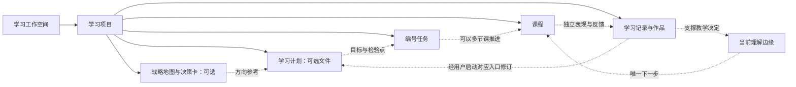

# DeepSeek Harness 学习插件：探索与构思

本稿是产品探索，不是已批准的实现规格。依据当前九个公开 skill 与工件契约整理，不修改学习流程或现有格式。Harness 接口核实见[插件能力调研](deepseek-harness-plugin-capabilities.md)。

**已确定的产品方向（用户本轮修订）：直接使用 DeepSeek Harness 主页作为学习工作台，必须先设定学习工作空间。** 参考 [dataelement/dsh-desktop](https://github.com/dataelement/dsh-desktop)，复用原生界面与会话；主页的精确扩展点及宿主适配边界另见[桌面主页与工作空间调研](dsh-desktop-home-workspace-research.md)。本文的“主页”指应用回到首页时出现的学习入口，不是额外侧栏里另开的学习应用。

## 产品定位与建议

暂名「学习工作台 / Learner Workspace」。承载多个学习项目，把方向选择、能力路线、行动和学习表现连起来，让学习者回答：我为什么学、现在做什么、已有证据支持我走到哪里。

建议一个可安装插件包，内部拆项目索引、战略、计划、任务、课堂、证据模块，共享项目解析和文件索引。初期不拆成多个分别保存进度的插件。

| 产品方向 | 主要体验 | 优势 | 局限 |
| --- | --- | --- | --- |
| 学习驾驶舱 | 多项目概况、近期变更、当前下一步 | 最快让已有文件可见 | 容易退化为只有数量的仪表盘 |
| 学习地图 | 阶段路线、依赖、理解分支 | 看清能力缺口和推进理由 | 关系不齐时容易制造虚假确定性 |
| 教学工作室 | 课程阅读、练习、教学会话、证据回看 | 最贴近日常学习 | 需要额外呈现整体路线 |

推荐：驾驶舱做入口，教学工作室做日常主场，学习地图作为按需切换的视图。首屏聚焦一条有来源的下一步。

## 领域关系



箭头是语义关系，不保证文件都有明确链接。无战略仍可计划，无计划文件仍可拆任务，无任务仍可教学。一项任务可以多节课推进，独立课程也可存在。缺少关系显示“尚未关联”，不靠名称猜成已确认事实。

战略地图按项目路径配置读取；跨项目总览只聚合明确登记的数据，不创造一个覆盖各项目的新战略权威文件。

## 主页与工作空间：先确定学习发生在哪里

应用主页即学习工作台。当前设计收敛为一次激活一个学习工作空间，空间内可有多个项目；保留切换工作空间的能力。当前仓库是 skill 的开发仓库，不自动把它设为用户的学习空间；本轮只讨论机制，不选择真实路径。

### 首次进入：未绑定工作空间

主页显示“选择你的学习工作空间”，主要动作是选择已有本地文件夹；可从 Harness 已登记空间中选择。桌面原生目录选择能力需按目标宿主适配，纯 Web 场景使用其受支持的路径登记方式，不能把浏览器文件夹句柄当 Host 路径。

选择后只读识别已有根指令、学习配置与项目布局，显示空间名称、根目录、发现的项目和配置情况。空目录也是有效选择。目录确认只绑定空间，不自动生成计划、任务、课程或学习画像。

已有配置可直接读取；缺少配置时提供显式“配置学习环境”入口，由 setup-learn-skills 创建或合并公共配置。工作空间绑定是本插件的前提，运行 setup 不是已有 skill 的新增强制前置。发现多个可能项目时让用户选择，不把每个子目录都识别为学习项目。

### 日常进入：已绑定工作空间

主页顶部显示工作空间名称与切换入口。主体先显示空间内项目，以及当前明确项目的下一步、任务和最近课程；一个项目可直接展开，多个项目保留清楚的项目切换。

主体可查看“全部项目”总览，也可聚焦一个明确项目。“全部项目”只用于浏览；开始编号任务或自由教学前必须确定项目，不能把总览当执行目录。任务、课程和证据列表在跨项目展示时始终带项目标签。原生历史会话若保持全局列表，也需呈现其原有空间与项目上下文，不能仅因主页筛选就误认为属于当前项目。

无项目时显示“尚未登记学习项目”，提供显式设置项目的入口，不把空空间伪装成完整学习系统。项目存在但尚无计划或课程时，各区展示对应空状态，不阻止已支持的直接教学。

### 身份与切换

Harness Workspace 与学习工作空间语义需分开核实：前者是运行时工作区登记，后者是根 Agent 规则及多项目布局的文件范围。尽量关联复用已有 Workspace，不预设二者必然一对一；项目 cwd、运行时 workspaceId 与会话归属的组合必须按实际 API 验证。

所有动作绑定“学习空间 + 项目 + 任务/课程”。切换空间时更换索引与选择状态，不重定向已有会话，不移动原目录。旧教学会话仍属于原空间与项目；回到旧会话时明确显示其上下文，不套用新主页选中的项目。原路径不可用时显示重新定位入口，不回退到进程 cwd。

学习资料留在选择的文件夹；Harness 的会话与模型设置继续由宿主管理，插件登记及缓存留在宿主支持的持久层。启动进程的 launch-root 不能当学习目录。

## 信息架构

主页顶部固定工作空间选择器与项目选择器；项目内五个目的地：**概览、方向与计划、任务、课堂、证据**。所有编号任务与教学动作同时携带空间和项目身份，避免两个项目的 01 混淆。资源与术语从相关内容就近进入。

“方向与计划”共用导航但内容分区：战略回答投入何处，计划回答如何形成能力，各有独立来源与更新入口。战略内容多时再考虑拆页。

### 项目总览

展示现实学习目标、当前教学下一步、待继续任务、最近有意义的理解变化与工件变更。首屏不设全局学习得分。

项目没有正式活跃/暂停字段时只做收藏和最近访问，不推断项目已暂停。文件修改时间只能叫“最近工件变更”，不能冒充实际学习时间。找不到教学下一步时明确提示，提供打开任务或显式启动教学的入口。

### 方向与计划

战略采用方向投入对照与决策卡列表：方向、已投入、反馈、下一阶段投入、机会成本、停止条件和待验证假设。没有数字时使用定性摘要。关闭决策卡也可能意味着决定放弃。

计划采用阶段路线与能力验收矩阵：当前阶段展开、远期折叠，显示进入条件、练习场景、产出和检查点。没有日期时使用顺序路线，不画有日期的甘特图。

调整方向和修改计划按钮显式进入对应 skill 的交互。点击入口不等于批准尚未讨论的计划；to-plan 仍在用户同意具体方案后写入。

### 任务

默认可扫描列表，可选看板。保留原始七种状态与自定义状态；“已收集证据”不能合并成“已完成”。

详情显示为什么做、起手动作、产出、完成标准、预计投入与已有实际耗时，以及关联课程与证据。主要动作“围绕这个任务学习”携带项目与完整编号。反馈区分请求已提交、课程已产出、证据已更新。

首版不做拖拽即改学习状态或一键勾选完成。以后增加直接编辑时需限定字段、核对外部修改；能力达标始终按证据判断。

### 课堂

大屏构思：课程目录、主体阅读区、上下文区；上下文显示本课目标、关联任务、当前理解边缘和证据。教学对话优先复用 Harness 原生会话；采用跳转还是并排布局，需按官方扩展点做原型验证。

首版支持已有 Markdown 与资源链接；本地 PDF 页码、图片和 HTML 的实际打开方式需验证。任意 HTML 课程不能直接承诺无损内嵌，需要验证隔离和资源访问。

阅读位置可以保存，但读完不标记掌握。练习答案交给教学会话反馈；插件里的答案草稿应明确标为草稿，不自动升级为学习证据。

### 证据与理解地图

默认用活跃知识分支表，保留四种证据状态：已验证、发展中、前置断层、待探测；另列教学动作：跳过、在理解边缘教学、补桥、探测。三区教学逻辑不能与四种证据状态混成三级评分。

结论展示来源、实际表现或自述、适用范围与未知。learning-record 可以只是短段落，也会保存自述先验知识，不能每份都标成独立检验通过。

旧记录被替代时保留历史。画像只含影响下一课的活跃分支，不据此绘制全部知识的永久掌握率。

## 首屏线框

以下仅为虚构示例，不是真实学习数据。

```text
DeepSeek Harness                    学习空间：我的学习 ▾
                                    项目：数据分析入门 ▾

目标：能独立解释业务指标，并完成一份可复核的分析

下一步 · 来自当前教学决定
换一个样本，独立解释留存率的分子、分母与观察窗口
原因：计算已验证，跨时间窗口的解释仍待探测
[继续学习]  [查看依据]
─────────────────────────────────────────────────────────
我的学习项目                   当前项目：数据分析入门
数据分析入门                   方向与计划 · 任务 · 课堂 · 证据
英语表达
                               当前任务：01 核对一个留存样本
                               已收集证据 · 一项验收待验证
─────────────────────────────────────────────────────────
当前项目的新对话
[输入想学习的问题……]                         [开始]
最近课程                       最近理解变化
留存率口径                     窗口变化后的判断：待探测
```

主页保留原生输入与进入会话的能力，学习上下文显示在输入旁。已有任务的“继续学习”指向该任务；自由输入默认只携带已明确的空间与项目，不额外启动未点选的 skill。

首次未绑定空间时，以上学习内容替换为选择空间的空状态，不能默认使用应用进程目录。

下一步优先显示已有画像里的唯一下一步，其次为明确任务的起手动作；来源冲突时展示差异，不能悄悄做出新的教学决定。

## 文件与插件状态边界

Markdown 是领域事实源；插件创建可重建的展示索引，不另存一套竞争性的学习进度。

索引建议包含项目身份、实体类型、来源路径、标题、原始状态、明确关系、定位锚点、内容版本与解析结果。任务身份至少是项目加稳定编号。项目身份可从登记路径派生，但迁移、符号链接去重需验证。

提取分三层：

1. 可确定的结构：标题、任务核心字段、表格、决策卡 frontmatter、显式链接。
2. 缺省信息：能力标签、日期、课程关联等，缺少留空，不为界面补造事实。
3. AI 建议：可以辅助找关联，但标为候选、附依据，经确认才视为明确关系；首版可不做。

不要求历史文件统一补 frontmatter。解析失败仍保留原文和提示。只索引登记的学习项目和配置路径，不把参考材料误判为课程或证据。

插件可保存收藏、筛选、阅读位置、布局、缓存、项目登记。领域写入遵循原入口边界；页面打开、文件变化或后台刷新不隐式启动 User-invoked skill。

## 视觉方向

成人学习工作台、内容优先、中等信息密度。优先沿用 Harness 主题、字体和控件；中文使用系统字体回退。路线采用细线与清晰阶段标签，状态同时有文字与颜色，每屏一个主要动作。

ui-ux-pro-max 首次搜索偏向儿童教育与营销页，第二次检索的扁平生产力风格更适合，但营销页布局仍不适用；不沿用自动生成的整套方案。这里的布局依据本项目领域重新组织。

列表优先于复杂看板，活跃分支表优先于大规模力导向图。图须有表格替代，关键操作不能只靠拖拽。辅助面板竞争空间时先折叠，并保留返回路径与阅读位置。

## Harness 中的落点

参考项目是 Dataelem 基于 Harness 的独立社区桌面应用，不是 DeepSeek 官方桌面产品。其官方[架构说明](https://github.com/dataelement/dsh-desktop/blob/main/docs/architecture.md)明确复用上游运行时与 UI；原生目录选择由桌面宿主提供，进程从独立 launch-root 启动。其当前固定 Harness 依赖为 0.2.1-rc.2，与上一轮调研的上游 master 不能视为同一版本。

该 Desktop 的 conversation 补丁增加 `desktop.workbench.frame`、`conversation.hero.modeActions`、`conversation.hero.dock` 接缝，为主页整合提供具体参考。这些是 Desktop 特有扩展，不是上游通用 API。frame 接收已有 Conversation，并以它作为无贡献时的回退，但当前已被内置 workbenches 注册为 single slot；学习插件不能再次抢占，完整主页应与现有 frame 集成或添加专属出口。hero.dock 仅在没有 sessionId 时显示，已有空白会话不会命中，因此空间选择不能只放在那里。具体来源见[专门调研](dsh-desktop-home-workspace-research.md)。

产品目标已确定为应用主页学习工作台。实现选择优先评估现有主页接缝，若目标是原版 Harness 则核对其等价能力；缺少合适接缝时需要最小宿主适配，不能把另加 main 页面当作已经满足主页要求。是否以 Desktop 为实际宿主尚未决定，当前只把它作为参考。

教学仍复用原生会话与会话右侧资源 tab。全局页面替代 conversation 时没有会话右栏，不能画成永远同时存在；主页辅助内容应在主页内部布局。

Host 负责按项目读取文件和生成展示快照，浏览器经 Remote 接口取得数据。文件 watch 可能不可用，通知也不保证断线重放，因此保留手动刷新与重连重读。

显式教学入口可组合正确 cwd/workspace 的会话创建或复用、会话 skill 目录检查、发送 `/teach-me 01` 与导航；官方没有一站式 launchSkill API。需使用实际返回会话 ID，防重复提交，且请求被接收不等于教学已完成。当前是可行方案，尚未在安装版实测。

第三方客户端 bundle 的打包与安装方式、当前桌面版与调研提交的对应关系仍待验证。上述结论不表示当前 GUI 已加载任何新页面。

## 首版范围

首版目标：看得见、能回到来源、能明确启动下一步。

- Harness 主页即学习入口；未绑定空间时显示空间选择，绑定后显示工作台。
- 必选学习工作空间，支持同一空间内多个项目与自定义路径，保留切换空间能力。
- 项目概览与有来源的下一步。
- 战略地图、决策卡和计划阶段浏览。
- 编号任务列表与详情。
- 课程基础阅读、学习画像和记录浏览。
- 原文入口；以已验证的 Harness 接口提供显式教学入口。
- 手动刷新必备，自动刷新方式根据实际接口选择。

后续：受控写回与差异预览、明确关联后的跨项目能力视图、更连贯的课程会话布局、有真实数据支持的投入趋势、AI 候选关联。

不纳入首版：自动重写战略、自动排日程、课程自动标掌握、完整 LMS、积分排行榜、公开协作平台。

## 下一轮原型要回答的问题

1. 初次主页选择空间后，能否识别已有布局、容纳空目录，并恢复上次绑定？
2. 主页 → 项目 → 01 任务 → 教学会话，是否始终保留正确空间和项目？
3. 看完一节课后，能否区分阅读状态、任务验收、能力证据？
4. 只有自然语言、缺关联字段的文件，是否仍可用且诚实展示缺口？
5. 页面与原生会话切换后，是否恢复当前课程和教学上下文？切换主页空间后，旧会话是否仍绑定原项目？
6. 只有课程的项目与计划任务齐全的项目，是否都能使用？

建议下一轮先做未配置/已配置两种主页，再验证任务到课堂、理解地图到证据；技术探针优先验证目标宿主的主页接缝、空间登记和会话目录语义。本轮不启动插件实现。

## 本地依据

- [公开入口与调用分类](../../skills/README.md)
- [共享工件边界](../../skills/ARTIFACTS.md)
- [领域词汇](../../CONTEXT.md)
- [战略地图与决策卡格式](../../skills/learn/strategyfinder/references/map-format.md)
- [计划格式](../../skills/learn/to-plan/references/plan-format.md)
- [任务格式](../../skills/learn/to-task/references/task-format.md)
- [教学说明](../teach-me.md)
- [学习画像格式](../../skills/learn/teach-me/references/LEARNER-PROFILE-FORMAT.md)
- [学习记录格式](../../skills/learn/teach-me/references/teach/LEARNING-RECORD-FORMAT.md)
